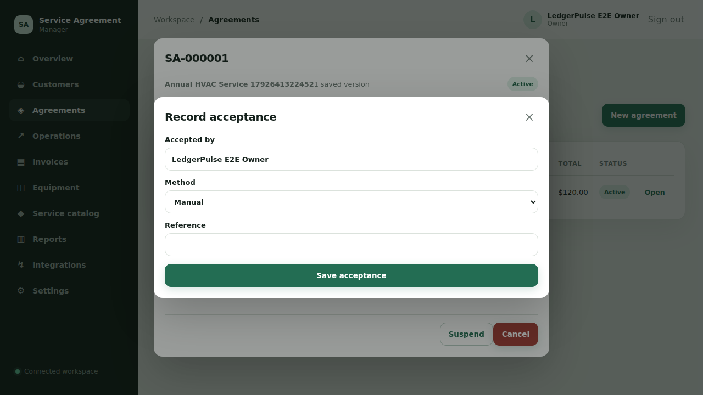

# LedgerPulse — End-to-End Visual Walkthrough

> Curated screenshots from verified browser states. The regression image is historical failure evidence and is deliberately not counted as a successful checkpoint.

**Tested source commit:** [`__TESTED_SHA__`](https://github.com/__REPOSITORY__/commit/__TESTED_SHA__)  
**CI workflow:** [Run #__RUN_ID__](__RUN_URL__)  
**Browser:** Chromium controlled by Playwright  
**Application build:** Vite production build served locally against the FastAPI backend on `main`  
**Database:** Disposable PostgreSQL 16  
**Viewport:** 1280 × 720 for most screenshots; homepage is captured full-page; reports is taller than the viewport.

## How to read this walkthrough

This report follows Sayphora's screenshot layout: journeys are ordered, images are displayed in aligned two-column HTML tables, and each screenshot has a caption describing the action and assertion. Images are captured only after checkpoint assertions succeed, except the separately labelled historical regression reproduction.

**Latest automated result:** __E2E_PASSED__ Playwright tests passed, __E2E_FAILED__ failed, __E2E_SKIPPED__ skipped. There are __CHECKPOINT_COUNT__ successful screenshot checkpoints. These checks provide broad integration evidence, **not a claim that every LedgerPulse feature or every edge case has been tested**.

**Backend verification:** __BACKEND_PASSED__ passed, __BACKEND_FAILED__ failures/errors, __BACKEND_SKIPPED__ skipped in the full backend suite; PostgreSQL concurrency checks: __PG_RACE_PASSED__ passed, __PG_RACE_FAILED__ failures/errors, __PG_RACE_SKIPPED__ skipped. Ruff and Alembic schema-consistency checks also run.

## Regression evidence — before and after the fix

__FAILURE_SCREENSHOT_NOTE__

<table><tbody><tr>
<td width="50%" valign="top"><h3>00. Before fix — acceptance modal remained open</h3>
<strong>Status: historical failure reproduction.</strong> The backend activated an agreement effective today, but the frontend acceptance modal stayed open. This image is not counted as a passed checkpoint.

<em>Viewport: 1280 × 720</em>
</td>
<td width="50%" valign="top"><h3>After fix — active agreement without the modal</h3>
<strong>Status: passed after fix.</strong> The acceptance flow now closes the modal, then verifies the active state followed by suspend/resume transitions.

<em>Viewport: 1280 × 720</em>
</td>
</tr></tbody></table>

## Verified user journeys

### Application entry and customer setup

<table><tbody>
<tr><td width="50%" valign="top"><h3>01. Public homepage</h3>
The production-built frontend loads from the local preview server. This is a UI smoke checkpoint, not a test of every landing-page link.

<em>Viewport: full page, 1280 px wide</em>
</td><td width="50%" valign="top"><h3>02. Invalid login</h3>
An unknown synthetic account is rejected with the expected 401 response and a readable login error.

<em>Viewport: 1280 × 720</em>
</td></tr>
<tr><td width="50%" valign="top"><h3>03. Dashboard after registration</h3>
A synthetic owner registers, receives an authenticated response, and reaches the dashboard.

<em>Viewport: 1280 × 720</em>
</td><td width="50%" valign="top"><h3>04. Customer, contact and service location</h3>
The browser creates a customer, billing contact and service location, then verifies persisted association and fields.

<em>Viewport: 1280 × 720</em>
</td></tr>
</tbody></table>

### Agreements and invoices

<table><tbody>
<tr><td width="50%" valign="top"><h3>05. Draft agreement</h3>
A draft agreement is created and the returned amount and customer association are checked.

<em>Viewport: 1280 × 720</em>
</td><td width="50%" valign="top"><h3>06. Agreement active</h3>
Proposal, acceptance, automatic effective-date activation, modal closure, suspension and resume are verified.

<em>Viewport: 1280 × 720</em>
</td></tr>
<tr><td width="50%" valign="top"><h3>07. Draft invoice</h3>
The invoice is created through the UI and customer, total and initial status are asserted.

<em>Viewport: 1280 × 720</em>
</td><td width="50%" valign="top"><h3>08. Invoice fully paid</h3>
The invoice is issued and fully paid; a later API read confirms paid status and zero balance due.

<em>Viewport: 1280 × 720</em>
</td></tr>
</tbody></table>

### Equipment and service catalogue

<table><tbody><tr><td width="50%" valign="top"><h3>09. Equipment created</h3>
The equipment is linked to the customer and location; returned IDs and serial number are checked.

<em>Viewport: 1280 × 720</em>
</td><td width="50%" valign="top"><h3>10. Service catalogue item created</h3>
The new service code and unit price are verified from the server response and UI.

<em>Viewport: 1280 × 720</em>
</td></tr></tbody></table>

### Field operations and maintenance

<table><tbody>
<tr><td width="50%" valign="top"><h3>11. Work order completed</h3>
The browser creates a technician, then creates, assigns, starts and completes a work order. API status transitions are asserted.

<em>Viewport: 1280 × 720</em>
</td><td width="50%" valign="top"><h3>12. Recurring billing active</h3>
A recurring billing schedule is created, paused and resumed. Background invoice generation is not tested.

<em>Viewport: 1280 × 720</em>
</td></tr>
<tr><td width="50%" valign="top"><h3>18. Maintenance plan generation</h3>
A plan with a checklist is created. Generating the same occurrence twice returns the same work-order ID, and the duplicate returns HTTP 200.

<em>Viewport: 1280 × 720</em>
</td><td width="50%" valign="top"></td></tr>
</tbody></table>

### CSV reporting and import recovery

<table><tbody><tr><td width="50%" valign="top"><h3>13. Reports and CSV exports</h3>
Four CSV exports download with expected filenames and contain test records created in the same journey.

<em>Viewport: 1280 × 886</em>
</td><td width="50%" valign="top"><h3>14. Customer import recovery</h3>
Preview flags a duplicate, valid rows import, the failed row is corrected and retried, and the job ends with 3 imported and 0 failed.

<em>Viewport: 1280 × 720</em>
</td></tr></tbody></table>

### Notifications and provider configuration

<table><tbody><tr><td width="50%" valign="top"><h3>15. Email queued</h3>
The email request persists with queued status. No sender worker is started and no email is delivered.

<em>Viewport: 1280 × 720</em>
</td><td width="50%" valign="top"><h3>16. SMS provider disabled</h3>
The backend returns 503 `sms_provider_disabled`; the UI surfaces the configuration error. No SMS is sent.

<em>Viewport: 1280 × 720</em>
</td></tr></tbody></table>

### Branch administration

<table><tbody><tr><td width="50%" valign="top"><h3>17. Branch hours and closures</h3>
A branch is created, Monday is updated to 08:00–17:00, persisted hours are checked, and a closure record is created.

<em>Viewport: 1280 × 720</em>
</td><td width="50%" valign="top"></td></tr></tbody></table>

### Extended finance, integrations and session security

<table><tbody>
<tr>
<td width="50%" valign="top"><h3>19. Invoice partial payment and reconciliation</h3>
A $100 invoice is issued and a $30 payment leaves a persisted partial balance. The same idempotency key replays the original payment; changed-content reuse and overpayment are rejected. The full API sequence then settles, refunds and credits the invoice.

<em>Viewport: 1280 × 720</em>
</td>
<td width="50%" valign="top"><h3>20. Integrations / webhook administration</h3>
The actual integrations screen shows the newly created HTTPS endpoint as Active after API-driven secret rotation. Assertions also verify HTTP URLs are rejected, the plaintext secret is absent from list responses, tenant isolation returns 404, and deactivation succeeds after the screenshot. No external receiver is called.

<em>Viewport: 1280 × 720</em>
</td>
</tr>
<tr>
<td width="50%" valign="top"><h3>21. Session cleared after logout</h3>
The cookie-authenticated refresh flow succeeds before logout. Logout returns 204, the authenticated identity endpoint then returns 401, and reopening the protected dashboard routes back to login. Password-recovery responses for known and unknown addresses are also checked for indistinguishable public messages.

<em>Viewport: 1280 × 720</em>
</td>
<td width="50%" valign="top"></td>
</tr>
</tbody></table>

### Recovery screens and invalid-link handling

<table><tbody>
<tr>
<td width="50%" valign="top"><h3>22. Password-reset request</h3>
The real form accepts a synthetic email and displays the same generic response used for an unknown email; the API assertions compare both messages to guard against account enumeration.

<em>Viewport: 1280 × 720</em>
</td>
<td width="50%" valign="top"><h3>23. Invalid password-reset link</h3>
A deliberately invalid one-time token produces a readable error, and the fragment token is removed from the address bar before form submission.

<em>Viewport: 1280 × 720</em>
</td>
</tr>
<tr>
<td width="50%" valign="top"><h3>24. Invalid email-verification link</h3>
An invalid verification token is rejected without activating the account; the UI clears the hash fragment and shows the backend's safe error message. Valid token/password setup is separately covered by backend tests, not by a real inbox.

<em>Viewport: 1280 × 720</em>
</td>
<td width="50%" valign="top"></td>
</tr>
</tbody></table>

## Feature coverage inventory

| Feature area | Coverage status | What was actually verified |
|---|---|---|
| Registration / sessions / recovery | **Partial pass — extended** | UI registration, session identity/refresh, logout/revocation, protected-route redirect, password reset request UI, invalid reset-token UI, invalid email-verification UI, anti-enumeration and removal of one-time token fragments from the address bar. Valid token/password flows are covered by the backend suite; actual email inbox delivery is not tested. |
| Customers / contacts / locations | **Partial pass** | Customer, billing-contact, location creation and CSV import/recovery. Edit/deactivate/search/pagination, attachments and all validations are not tested. |
| Agreements | **Partial pass** | Draft → proposed → effective-today active → suspend/resume; modal defect reproduced/fixed. Cancel, renewals, expiry, future-start acceptance and all invalid transitions are not tested. |
| Invoices / payments | **Partial pass — extended** | Draft/issue/full payment in the UI journey; extended browser-origin API flow covers partial payment, replayed idempotency key, changed-payload conflict, overpayment rejection, full settlement, refund, credit, void transition and PDF response. Tax/discount combinations, provider payment gateways and all race conditions are not all exercised. |
| Equipment / service catalogue | **Partial pass** | One equipment record and one service item created and persisted. Update, deactivate/decommission, delete and filter paths are not tested. |
| Work orders / technician access | **Partial pass** | Create → assign → start → complete using owner session and synthetic technician. Technician self-login, edit/cancel, appointment validation and checklist enforcement are not tested. |
| Maintenance plans | **Partial pass** | Plan created, order generated and repeated occurrence is idempotent. Schedule editing/deactivation and due-date/checklist edge cases are not tested. |
| Branches | **Partial pass** | Branch creation, Monday hours and closure creation. Duplicate codes, invalid timezones, closure deletion and primary-branch changes are not tested. |
| Recurring invoices | **Partial pass** | Create, pause and resume. Background scheduler and automatic invoice creation are not tested. |
| Reports / CSV | **Partial pass** | Four CSV exports and their contents; import duplicate recovery. All filters, pagination boundaries and formula-injection cases are not tested. |
| Email / SMS | **Partial pass** | Email outbox queue persistence and provider-disabled SMS error; backend suite checks queue/business rules. Live SMTP inbox delivery and provider-enabled SMS are not tested. |
| Webhooks / attachments | **Partial pass — extended** | Browser-origin API flow verifies attachment upload/list/update/download checksum/delete and tenant isolation; webhook HTTPS-only validation, CRUD, secret redaction/rotation, tenant isolation and deactivation. Backend tests cover webhook signature/retry worker behavior. A live external webhook receiver and production object storage are not exercised. |
| Authorization / security | **Partial pass** | Cross-tenant customer lookup returns 404; untrusted Origin returns 403. Full RBAC matrix, rate limits and all tenant-scoped endpoints are not tested. |
| Hosted production | **Not tested** | The suite used a local production build, local API and disposable PostgreSQL, not the hosted domain. |

## Explicit scope boundaries

- This is broad cross-layer coverage, **not an exhaustive test of every LedgerPulse feature**. Untested items above must not be read as passed.
- Live Vercel-to-backend connectivity, production HTTPS cookies, proxy/CORS behavior and production configuration remain unverified.
- Email is queued but not delivered; SMS takes the provider-disabled path. No live payment, refund, carrier, email, SMS or webhook provider was exercised.
- All test records use a disposable database and synthetic data; no production customer data was used.

---

**Evidence policy:** images are captured after successful checkpoint assertions. The before-fix screenshot is retained only to document the reproduced agreement-modal defect. Playwright traces and service logs remain in CI artifacts, not in this visual gallery.
