# Service Agreement Manager — Product Walkthrough

Service Agreement Manager brings the day-to-day work of a service business into one connected workspace: customers and service locations, service agreements, equipment, field work, recurring maintenance, invoices, payment adjustments, reporting and integrations.

The guide follows a practical customer journey—from discovering the product and creating a workspace through managing service delivery and collecting payment. Each image is a genuine screenshot of the running application, captured only after its corresponding browser interaction completed successfully.

## 1. Start here: the workspace

<table><tbody>
<tr>
<td width="50%" valign="top"><h3>Discover the product</h3><a href="docs/testing/visuals/01-public-homepage.png">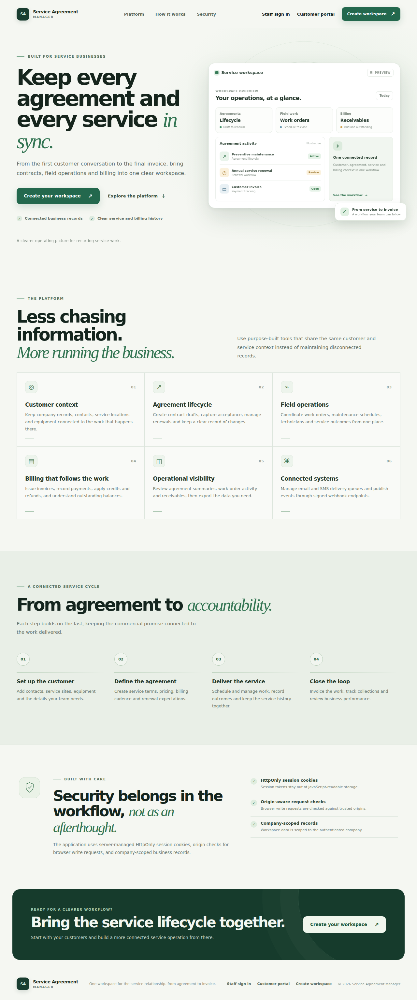</a>
The public landing page introduces the product and the connected workflow it provides to service businesses.
</td>
<td width="50%" valign="top"><h3>Sign in</h3><a href="docs/testing/visuals/26-sign-in-screen.png">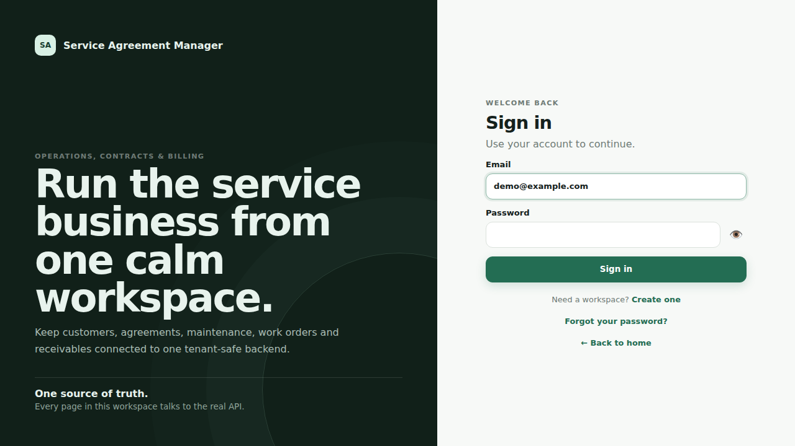</a>
Existing team members enter through the dedicated sign-in page to return to their workspace.
</td>
</tr>
<tr>
<td width="50%" valign="top"><h3>Create a company workspace</h3><a href="docs/testing/visuals/27-create-workspace-form.png">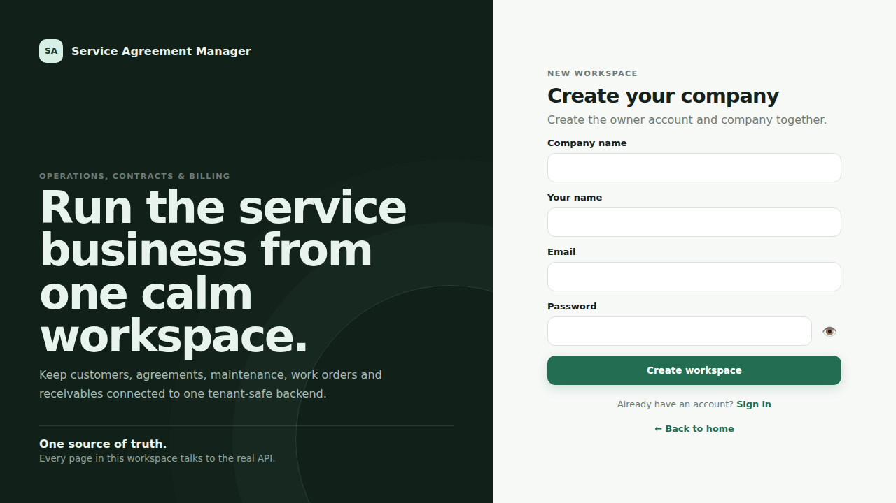</a>
The workspace owner provides company, contact and account details before continuing into the application.
</td>
<td width="50%" valign="top"><h3>Workspace overview</h3><a href="docs/testing/visuals/03-dashboard-after-registration.png">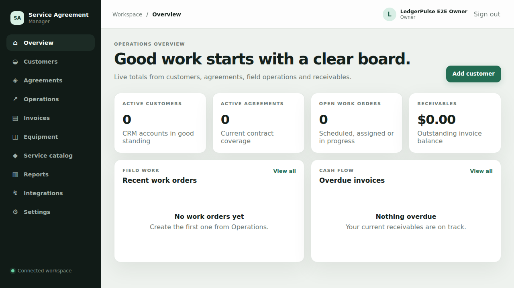</a>
The overview brings the user's operational workspace together after registration and sign-in.
</td>
</tr>
</tbody></table>

## 2. Build the customer record

Customers are the foundation that connects service locations, equipment, agreements and billing. The application supports customer details, contacts, service addresses and bulk import workflows.

<table><tbody>
<tr>
<td width="50%" valign="top"><h3>Customer, contact and service location</h3><a href="docs/testing/visuals/04-customer-and-service-location.png">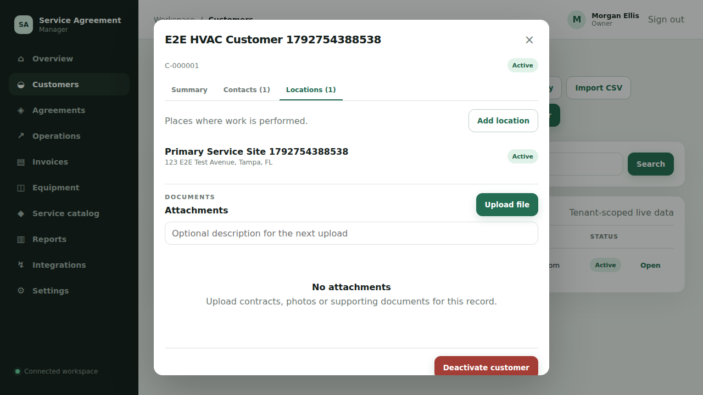</a>
A customer record can be associated with its billing contact and the site where work is performed.
</td>
<td width="50%" valign="top"><h3>Import customer records</h3><a href="docs/testing/visuals/14-customer-import-recovery.png">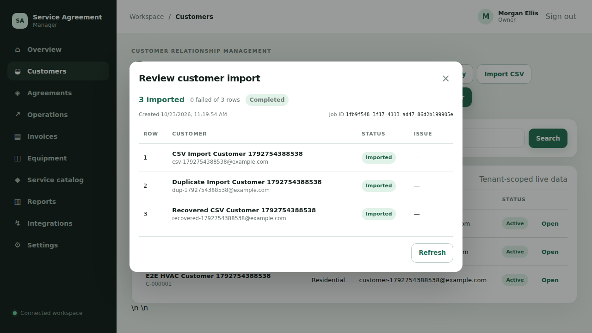</a>
The import flow previews rows, identifies a duplicate and lets the user correct a failed row before completing the import.
</td>
</tr>
</tbody></table>

## 3. Create and manage service agreements

Agreements define the service relationship with a customer. The workflow demonstrates a draft agreement moving through proposal and acceptance, then into an active state with lifecycle controls.

<table><tbody>
<tr>
<td width="50%" valign="top"><h3>Prepare an agreement</h3><a href="docs/testing/visuals/05-agreement-draft.png">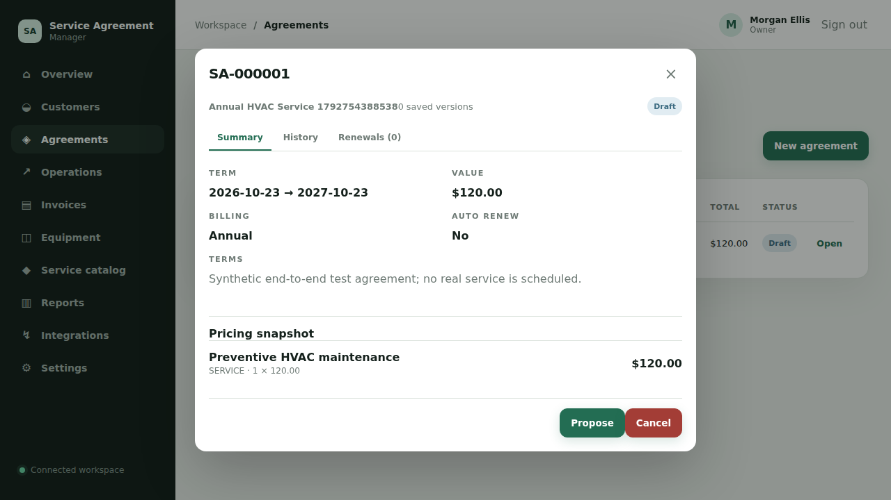</a>
Start with a draft, select the customer and prepare the commercial details before presenting the agreement.
</td>
<td width="50%" valign="top"><h3>Active agreement</h3><a href="docs/testing/visuals/06-agreement-active.png">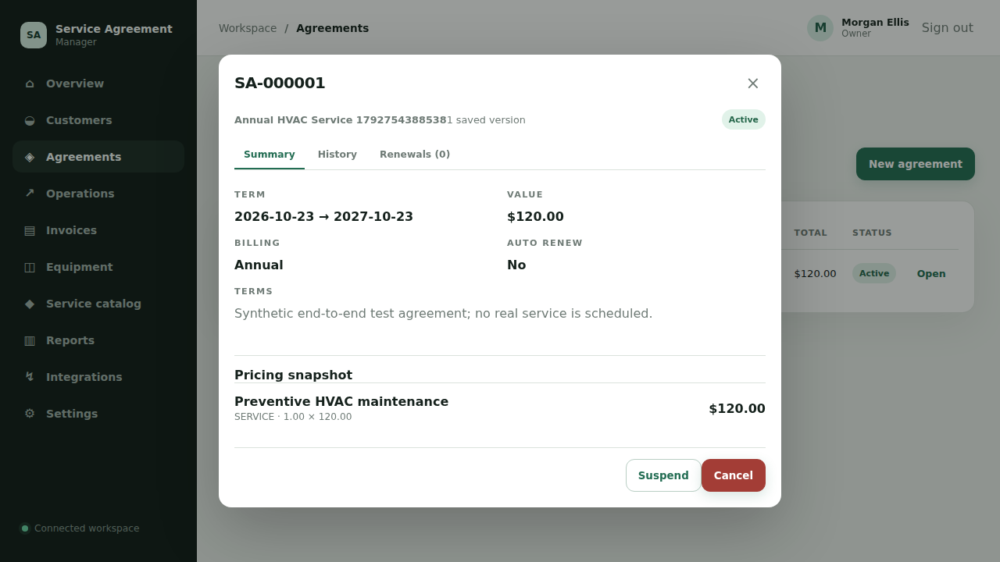</a>
The accepted agreement reaches its active state; the workspace also supports suspension and resumption of the agreement lifecycle.
</td>
</tr>
</tbody></table>

## 4. Coordinate service delivery

The same workspace keeps assets, the service catalogue, technician work and maintenance planning connected to the customer relationship.

<table><tbody>
<tr>
<td width="50%" valign="top"><h3>Equipment registry</h3><a href="docs/testing/visuals/09-equipment-created.png">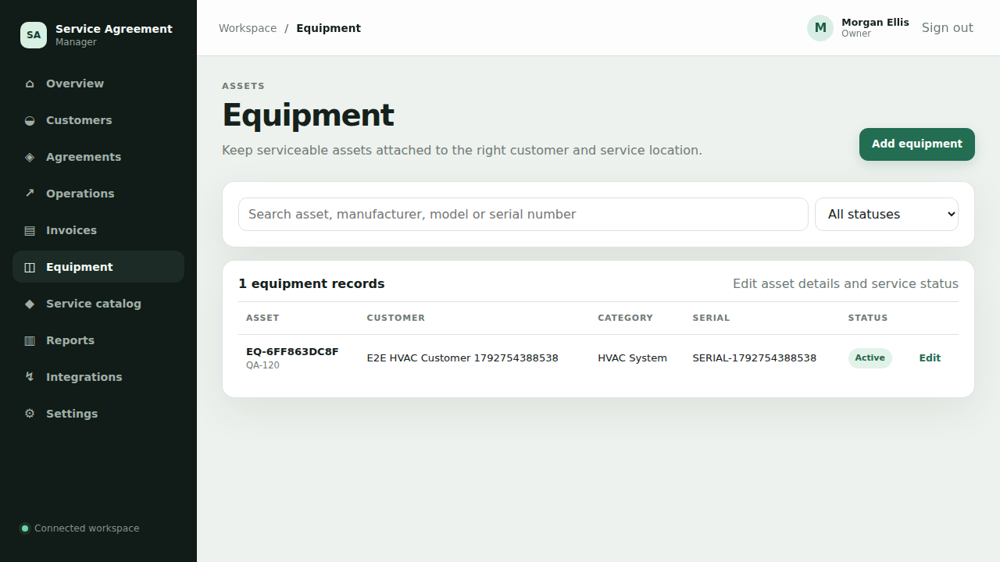</a>
Register the equipment that technicians need to maintain at a customer's site.
</td>
<td width="50%" valign="top"><h3>Service catalogue</h3><a href="docs/testing/visuals/10-service-catalog-created.png">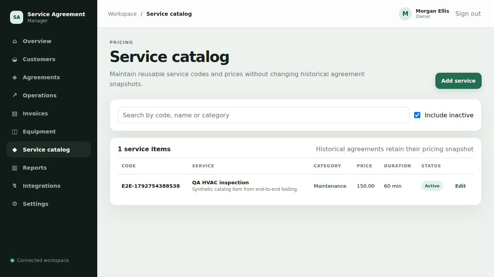</a>
Reusable service items provide consistent descriptions and prices for agreements and operational work.
</td>
</tr>
<tr>
<td width="50%" valign="top"><h3>Work order lifecycle</h3><a href="docs/testing/visuals/11-work-order-completed.png">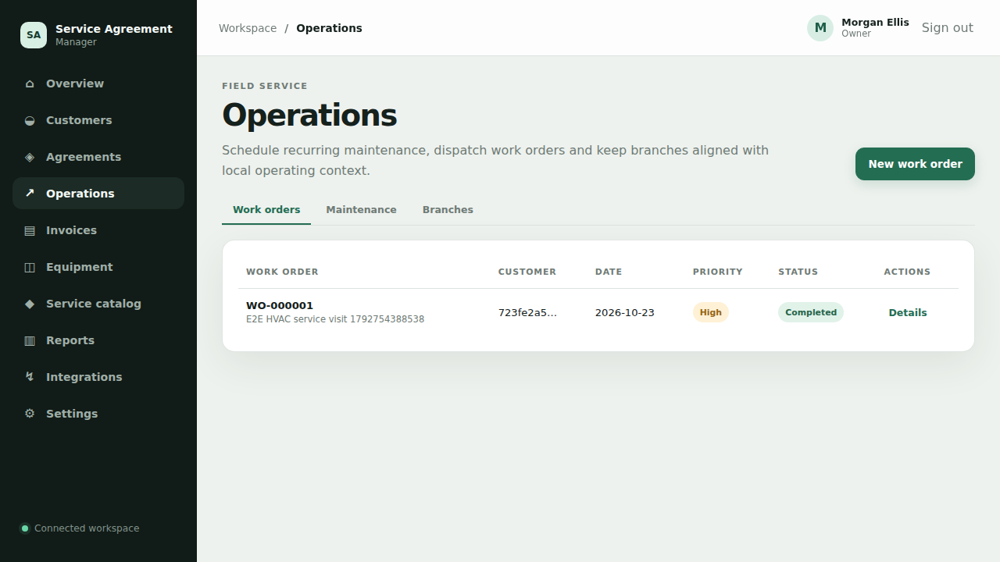</a>
A work order can be created, assigned, started and completed so the operational status follows the real workflow.
</td>
<td width="50%" valign="top"><h3>Maintenance plan generation</h3><a href="docs/testing/visuals/18-maintenance-plan-generation.png">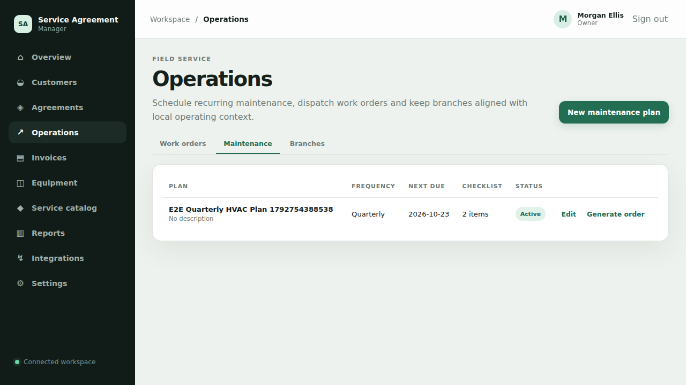</a>
Maintenance plans turn planned occurrences into work orders; repeating the same occurrence does not create a duplicate order.
</td>
</tr>
<tr>
<td width="50%" valign="top"><h3>Branch hours and closures</h3><a href="docs/testing/visuals/17-branch-hours-and-closures.png">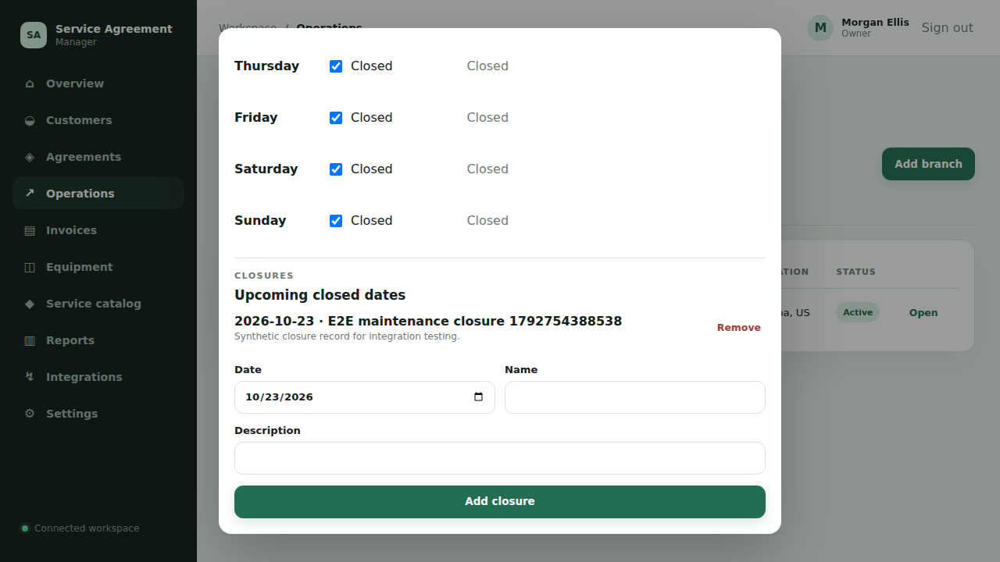</a>
Branch schedules and dated closures help represent when a service location is available.
</td>
<td width="50%" valign="top"><h3>Recurring maintenance billing</h3><a href="docs/testing/visuals/12-recurring-billing-active.png">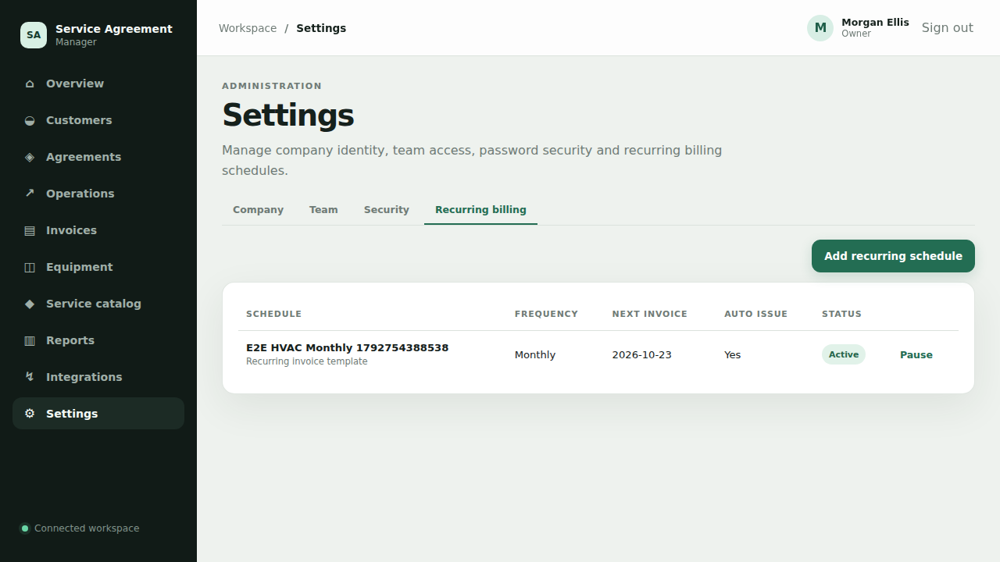</a>
Recurring invoice schedules can be created, paused and resumed as billing needs change.
</td>
</tr>
</tbody></table>

## 5. Manage invoices and money movement

Invoices start as drafts, can be issued and paid, and retain their balance and adjustment history. These screens demonstrate both the straightforward payment path and a more detailed adjustment journey.

<table><tbody>
<tr>
<td width="50%" valign="top"><h3>Prepare an invoice</h3><a href="docs/testing/visuals/07-invoice-draft.png">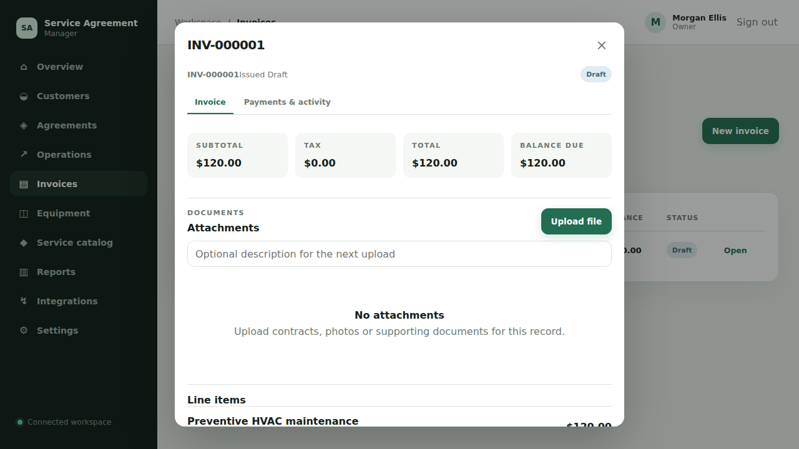</a>
Review the customer, invoice total and draft state before issuing a bill.
</td>
<td width="50%" valign="top"><h3>Record a fully paid invoice</h3><a href="docs/testing/visuals/08-invoice-paid.png">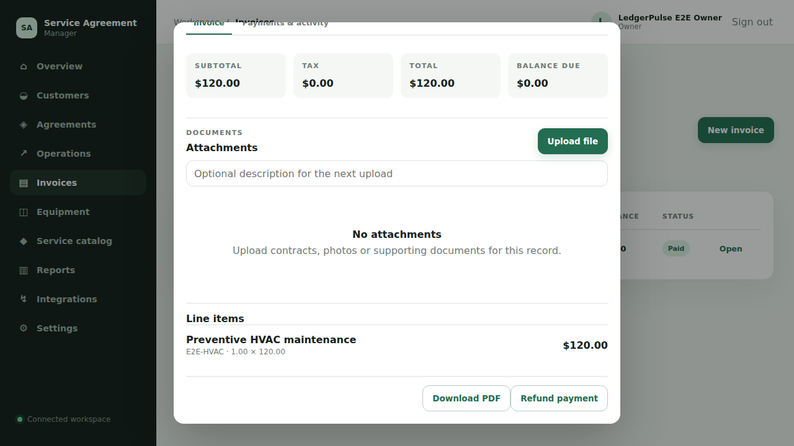</a>
After issuing and receiving payment, the invoice shows a paid state and no remaining balance.
</td>
</tr>
<tr>
<td width="50%" valign="top"><h3>Partial payment and balance</h3><a href="docs/testing/visuals/19-invoice-partially-paid.png">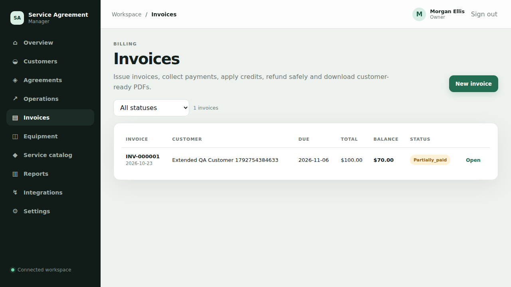</a>
Partial receipts leave a visible outstanding balance and preserve the payment history.
</td>
<td width="50%" valign="top"><h3>Payments, refunds and credits</h3><a href="docs/testing/visuals/25-invoice-adjustments-ui.png">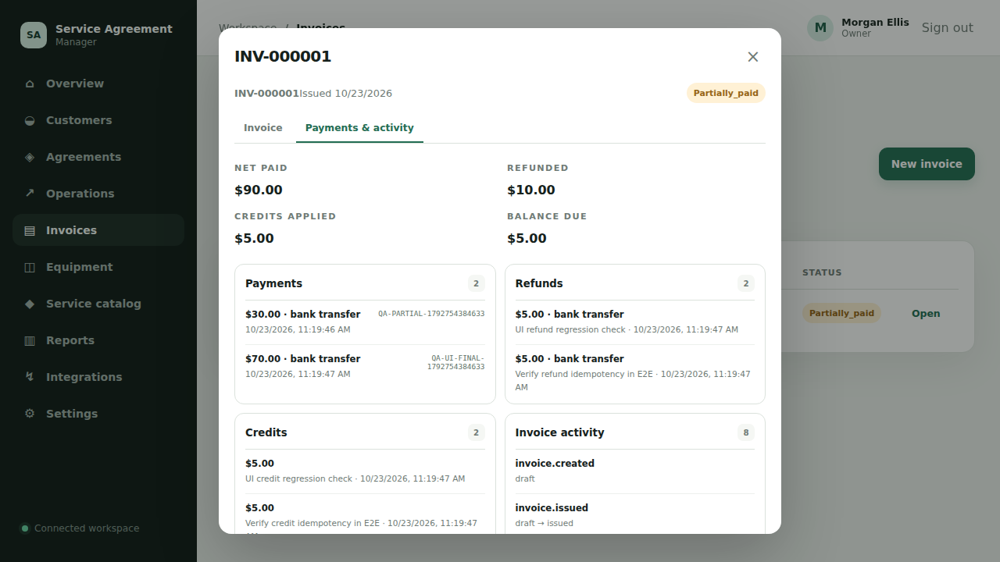</a>
The invoice detail workflow records additional payments, refunds and credits, keeping the resulting financial history in one place.
</td>
</tr>
</tbody></table>

## 6. Review business activity and export data

Reports help the business review operational activity and take structured data into other tools.

<table><tbody><tr><td width="100%" align="center" valign="top"><a href="docs/testing/visuals/13-reports-and-csv-exports.png">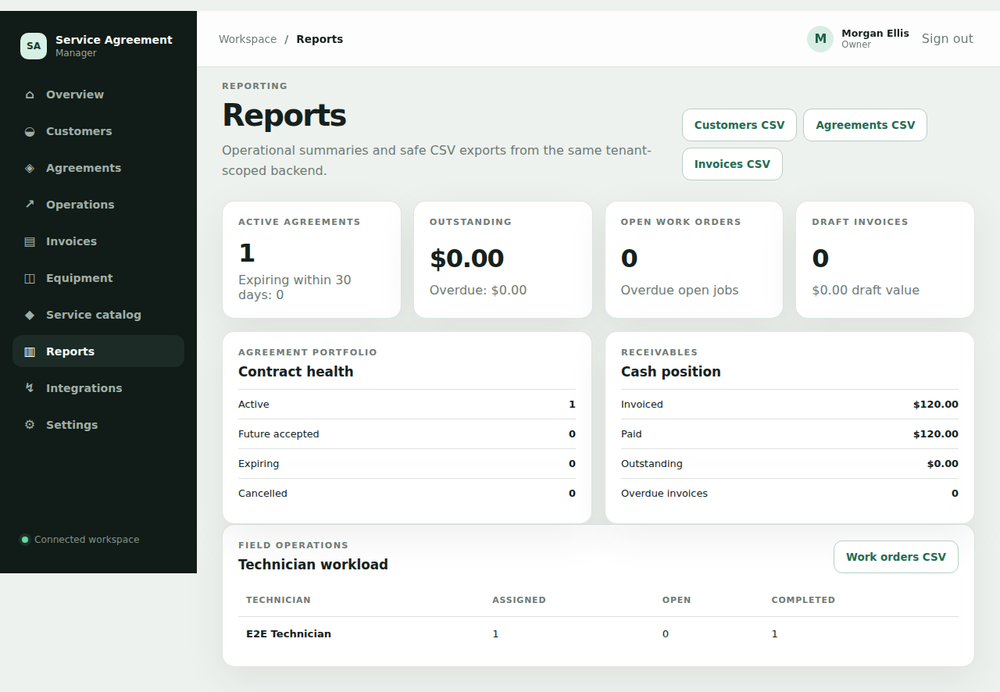</a>
Operational and finance reports provide downloadable CSV exports for further analysis and record keeping.
</td></tr></tbody></table>

## 7. Notifications and integrations

The application includes durable notification queues and webhook endpoint management. The screenshots distinguish between application-side workflow and external provider delivery.

<table><tbody>
<tr>
<td width="50%" valign="top"><h3>Email notification queue</h3><a href="docs/testing/visuals/15-email-queued.png">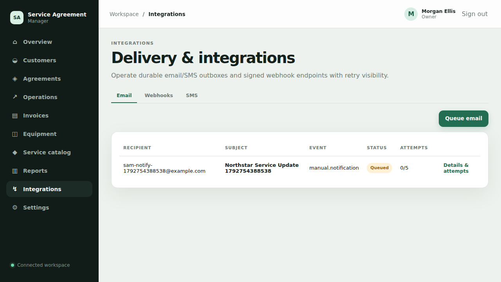</a>
The application persists an email request in its outbox. Actual delivery requires a configured sender and worker.
</td>
<td width="50%" valign="top"><h3>SMS provider configuration</h3><a href="docs/testing/visuals/16-sms-provider-disabled.png">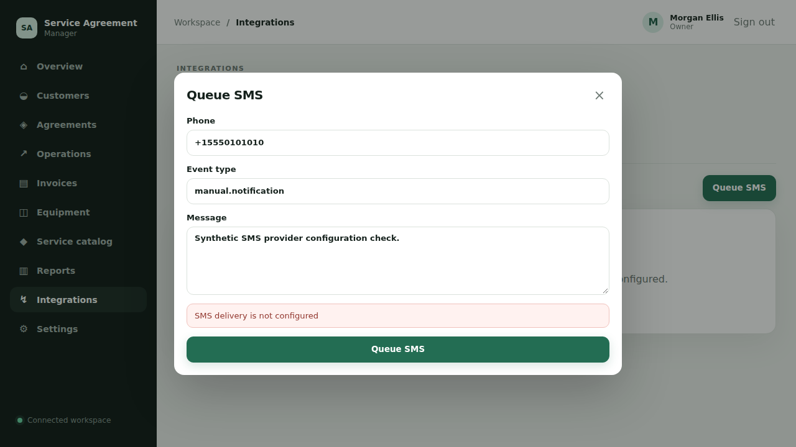</a>
When an SMS provider is not configured, the application surfaces the limitation rather than implying a message was sent.
</td>
</tr>
<tr>
<td width="50%" valign="top"><h3>Webhook integration management</h3><a href="docs/testing/visuals/20-integrations-webhooks.png">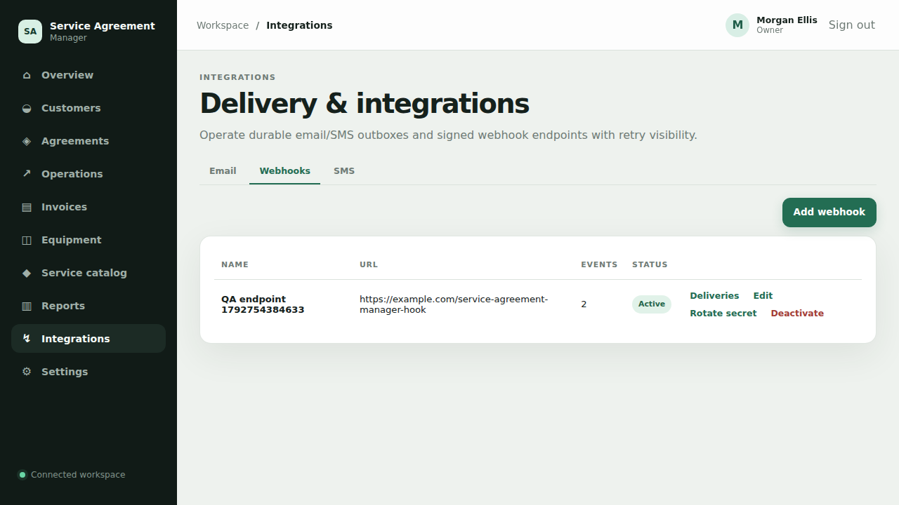</a>
Webhook endpoints can be managed within the workspace, with checks for HTTPS URLs, secret handling and tenant isolation.
</td>
<td width="50%" valign="top"></td>
</tr>
</tbody></table>

## 8. Account security and recovery

The account journey includes readable authentication feedback, password recovery and invalid-link handling. One-time tokens are removed from the browser address bar so they are not left visible in the page URL.

<table><tbody>
<tr>
<td width="50%" valign="top"><h3>Invalid sign-in feedback</h3><a href="docs/testing/visuals/02-login-invalid-credentials.png">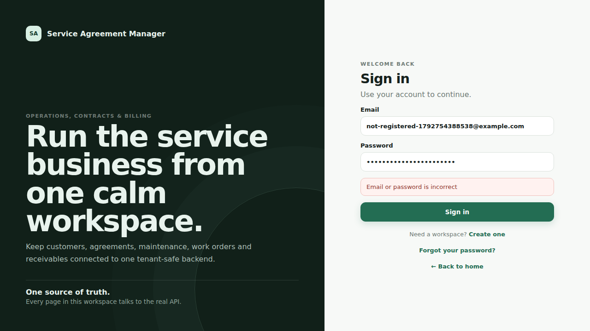</a>
Incorrect credentials produce an explicit, user-readable message without leaving the form in a stuck state.
</td>
<td width="50%" valign="top"><h3>Request password recovery</h3><a href="docs/testing/visuals/22-password-reset-request.png">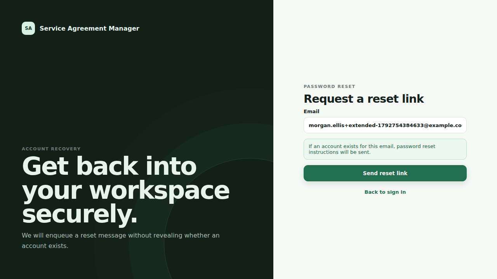</a>
The same generic confirmation avoids disclosing whether an email address belongs to an account.
</td>
</tr>
<tr>
<td width="50%" valign="top"><h3>Invalid password reset link</h3><a href="docs/testing/visuals/23-password-reset-invalid-token.png">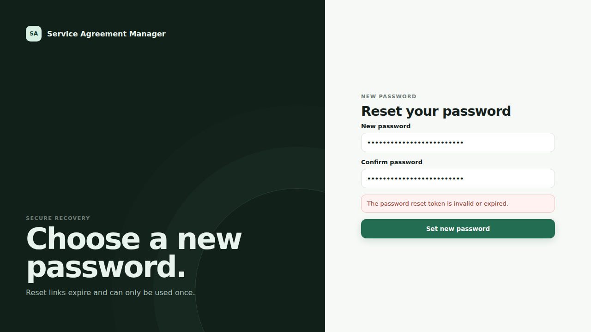</a>
An invalid or expired link is rejected with a clear message, while the single-use token is scrubbed from the address bar.
</td>
<td width="50%" valign="top"><h3>Invalid email verification link</h3><a href="docs/testing/visuals/24-email-verification-invalid-token.png">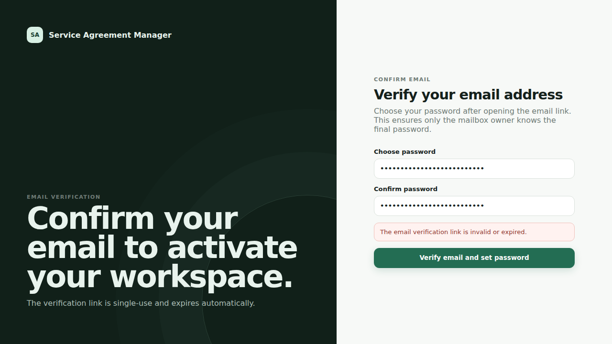</a>
Expired or invalid verification links are handled safely without silently activating the account.
</td>
</tr>
<tr>
<td width="50%" valign="top"><h3>Session after logout</h3><a href="docs/testing/visuals/21-session-after-logout.png">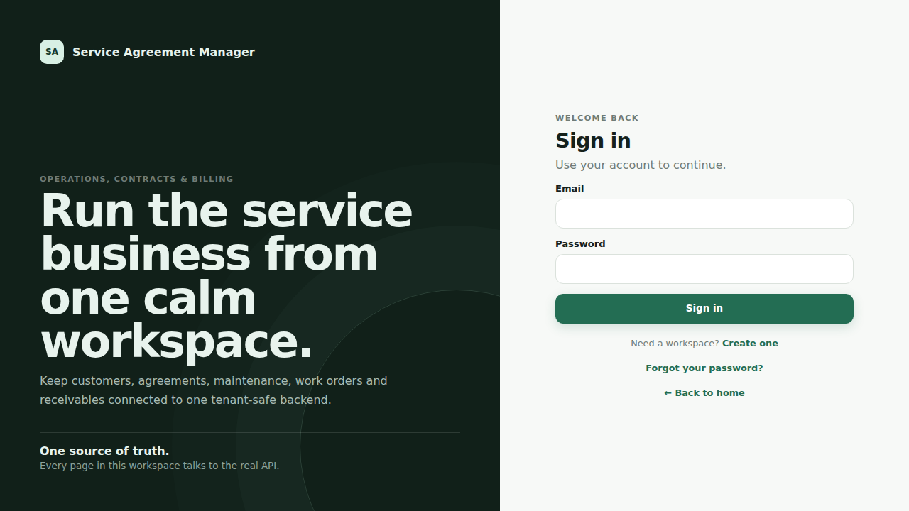</a>
After logout, the revoked session no longer grants access to protected workspace pages.
</td>
<td width="50%" valign="top"></td>
</tr>
</tbody></table>

## How the application fits together

- **Customer relationship management:** customer profiles, billing contacts, service locations and imports.
- **Agreement lifecycle:** pricing, proposals, acceptance, active status, lifecycle actions and renewals.
- **Service operations:** equipment, reusable catalogue items, work orders, maintenance schedules and branches.
- **Billing:** invoices, balances, payments, refunds, credits, PDFs and recurring invoices.
- **Visibility and integrations:** reports, CSV exports, queued notifications, SMS configuration and webhooks.
- **Security:** authenticated workspace access, session revocation, recovery links and tenant-scoped data.

The frontend uses React and Vite; the backend exposes the business API through FastAPI, with PostgreSQL persistence and database migrations. The frontend repository and backend repository each contain their own setup and deployment guidance.

## Evidence and practical limits

All images in this walkthrough are captured from the running application after the corresponding browser action succeeds. The walkthrough run uses a production-built frontend preview, the backend repository's `main` branch and an isolated PostgreSQL database with synthetic data. It demonstrates the connected application flows in this repository; it does **not** by itself prove that a hosted production deployment is reachable, that SMTP/SMS or external webhook recipients are configured, or that every possible role and edge case is covered.

**Source commit:** [`10a53ed34d97275a05c3de8f6c6267254506442e`](https://github.com/faizansaiyed123/service-agreement-manager-frontend/commit/10a53ed34d97275a05c3de8f6c6267254506442e) · **Successful walkthrough run:** [Run #39945081941](https://github.com/faizansaiyed123/service-agreement-manager-frontend/actions/runs/39945081941)

For setup details, architecture, API modules and deployment instructions, see the [frontend README](https://github.com/faizansaiyed123/service-agreement-manager-frontend/blob/main/README.md) and [backend README](https://github.com/faizansaiyed123/service-agreement-manager-backend/blob/main/README.md).
